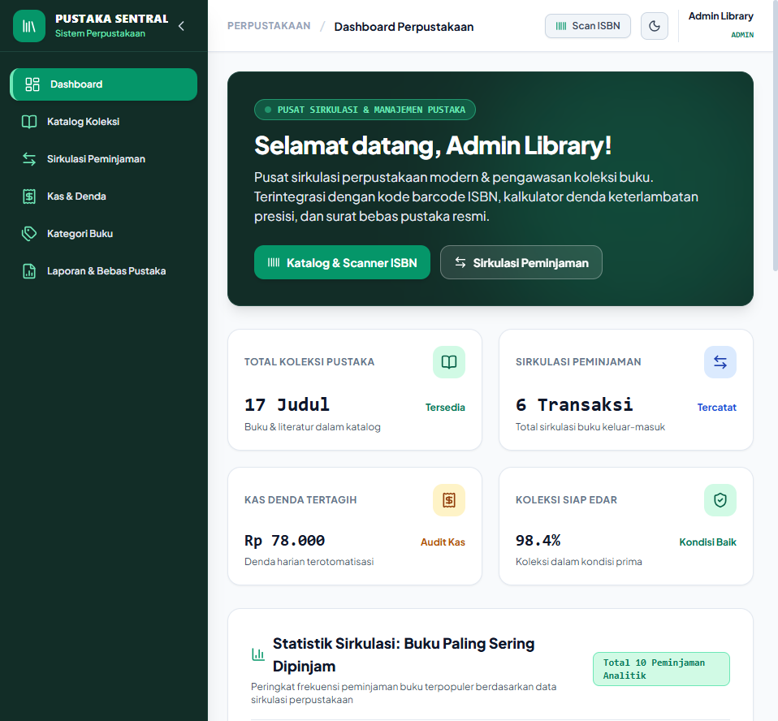
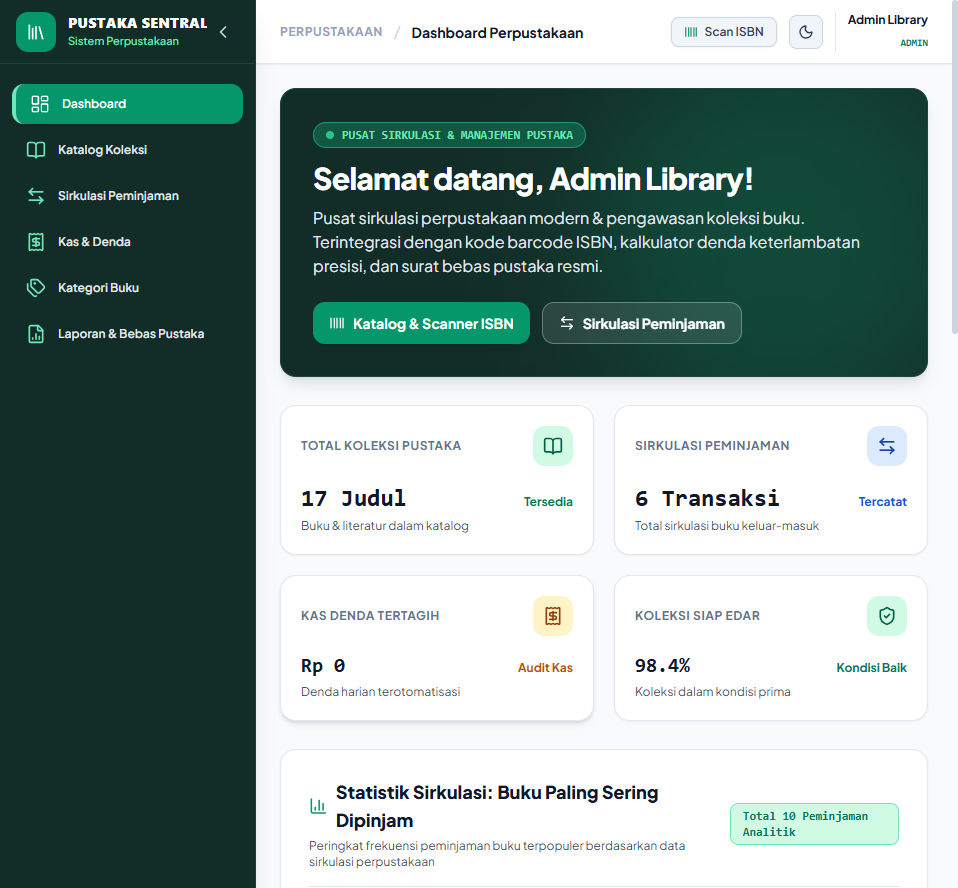
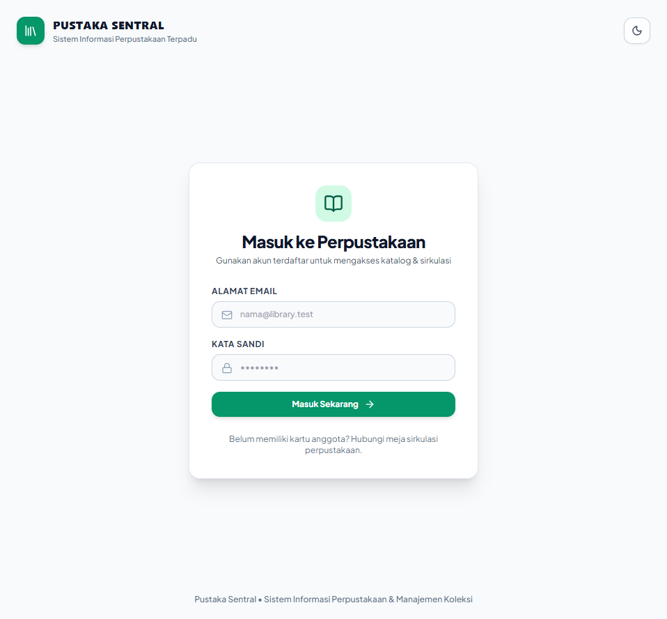
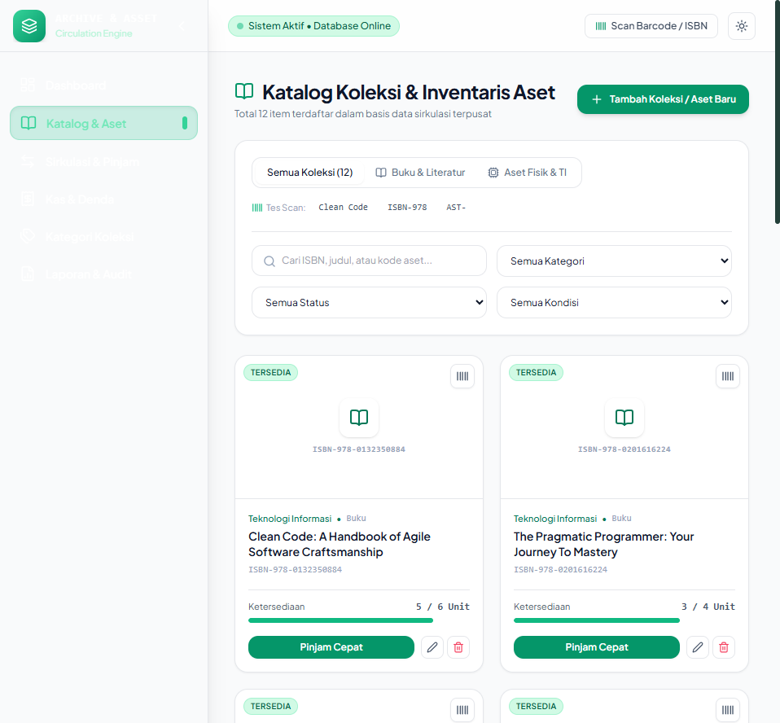
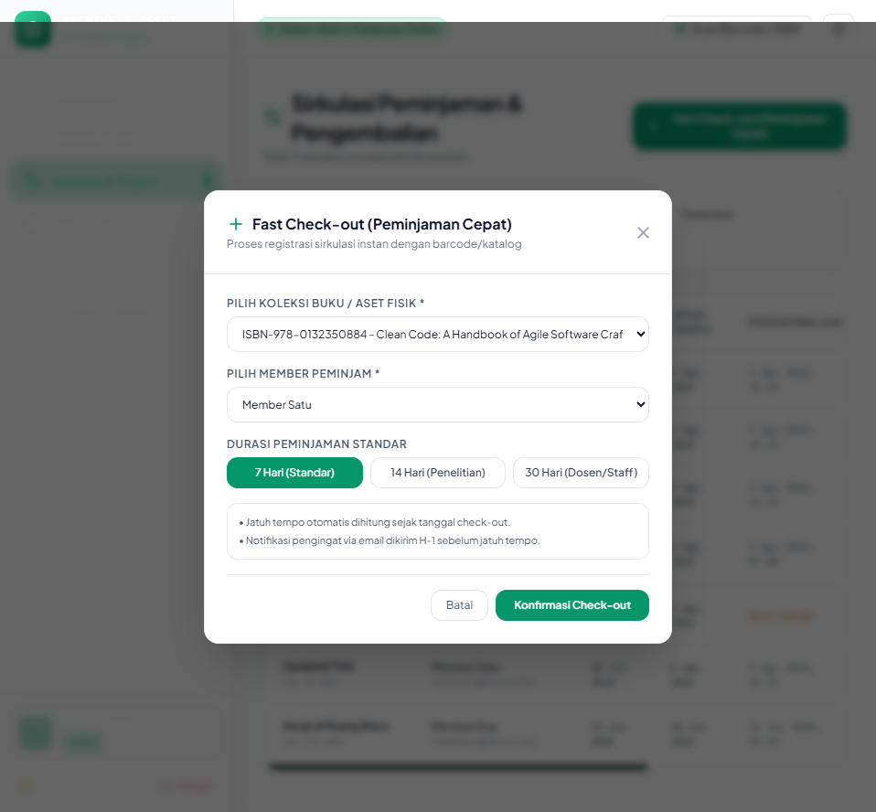
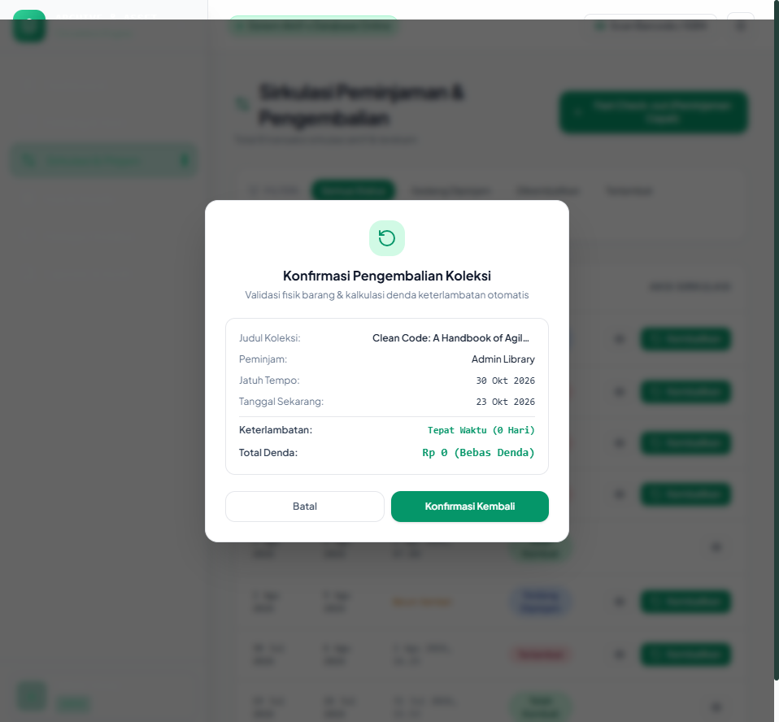
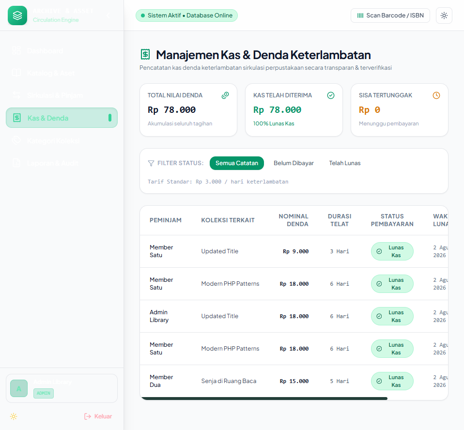

# PUSTAKA SENTRAL — Sistem Informasi Perpustakaan & Sirkulasi Koleksi (Frontend)

Modern, responsive web frontend untuk sistem informasi sirkulasi perpustakaan terpadu. Dibangun dengan palet **Sage Forest & Warm Sand**, tata letak **Responsive Fluid Full-Width**, navigasi **Collapsible Sidebar**, dukungan **Dark Mode**, pemindaian **Barcode/ISBN**, **Chart Analitik Sirkulasi Buku Terpopuler**, sirkulasi **Fast Check-in/Check-out** dengan kalkulator denda otomatis presisi, serta penerbitan **Surat Keterangan Bebas Perpustakaan** resmi.

---

## 📸 Antarmuka Sistem & Portfolio Showcase

<p align="center">
  
  <br/>
  <em>Dashboard Pustaka Sentral — Lengkap dengan Fitur Chart Analitik Buku Paling Sering Dipinjam</em>
</p>

<details open>
<summary><strong>Lihat Dokumentasi Fitur Utama ▾</strong></summary>

| Fitur / Modul | Preview Antarmuka |
|---|---|
| **Chart Statistik Buku Terpopuler**<br/>Grafik persentase frekuensi peminjaman koleksi buku paling diminati secara real-time. |  |
| **Login Bersih & Otentik**<br/>Formulir autentikasi profesional tanpa elemen demo dummy, siap produksi. |  |
| **Katalog & Filter Barcode ISBN**<br/>Pencarian instan kode ISBN/barcode, filter literatur vs hardware TI, dan stok meter. |  |
| **Sirkulasi & Fast Check-out**<br/>Peminjaman kilat terintegrasi dengan durasi adaptif (7/14/30 hari). |  |
| **1-Click Return & Kalkulator Denda**<br/>Perhitungan otomatis keterlambatan harian (Rp 3.000/hari) saat barang dikembalikan. |  |
| **Format Sertifikat Bebas Pustaka Cetak**<br/>Layout kop surat resmi dengan validasi digital QR code & tanda tangan kepala pustakawan. |  |
| **Manajemen Kas & Denda Keterlambatan**<br/>Monitoring kas masuk, audit denda per member, dan verifikasi status lunas. |  |

</details>

---

## ✨ Fitur Unggulan

1. **Branding Pustaka Sentral**: Identitas sistem perpustakaan institusional yang otentik dan profesional.
2. **Chart Analitik Sirkulasi Buku**: Visualisasi batang interaktif yang memeringkatkan koleksi buku yang paling sering dipinjam lengkap dengan kategori dan persentase pangsa sirkulasi.
3. **Responsive Full-Width Layout**: Tata letak fleksibel yang memanfaatkan lebar layar perangkat secara penuh tanpa terpotong di berbagai resolusi layar.
4. **Clean Top Navbar**: Menghilangkan kapsul status dekoratif yang tidak perlu, berfokus pada informasi navigasi yang fungsional (*breadcrumb*, *search*, *theme switcher*).
5. **Autentikasi Bersih**: Form login terstandardisasi dan aman tanpa tombol demo instan.
6. **Multi-Role Responsiveness**: Antarmuka adaptif untuk peran **Administrator**, **Staff**, dan **Member Pembaca**.

---

## 🛠️ Tech Stack

| Komponen | Spesifikasi |
|---|---|
| **Framework** | React 18.3 |
| **Build Tool** | Vite 5.4 |
| **Styling** | Tailwind CSS 3.4 (Custom Theme & Dark Mode) |
| **Icons** | Lucide React |
| **Routing** | React Router DOM 6.26 |
| **HTTP Client** | Axios 1.7 |
| **Notifications** | React Hot Toast |

---

## 🚀 Menjalankan Project

```bash
# Install dependencies
npm install

# Jalankan dev server
npm run dev

# Build untuk produksi
npm run build
```
