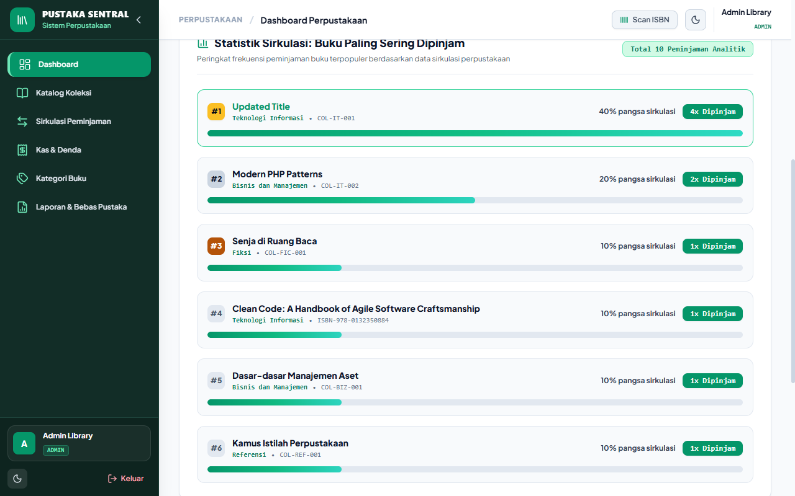
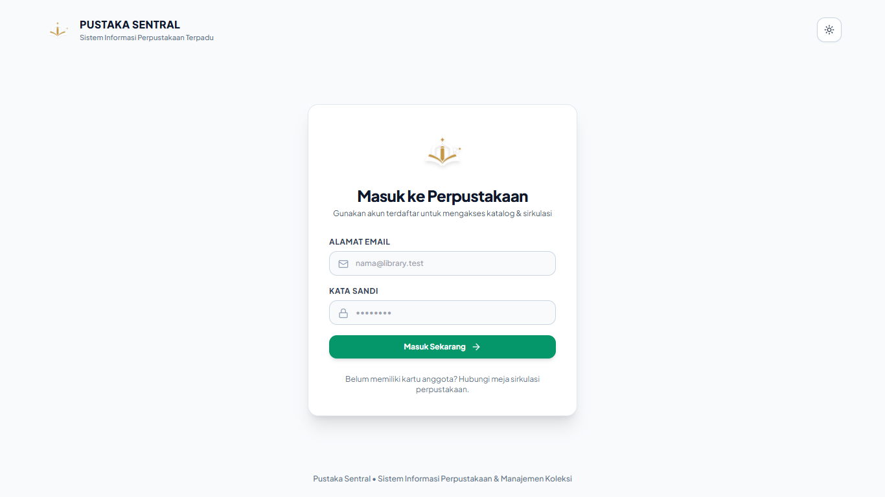
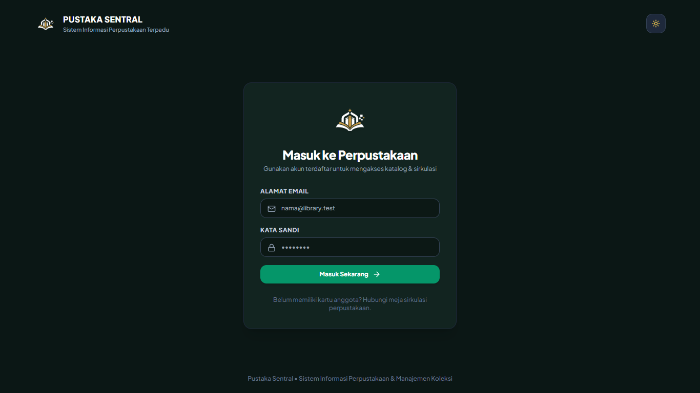
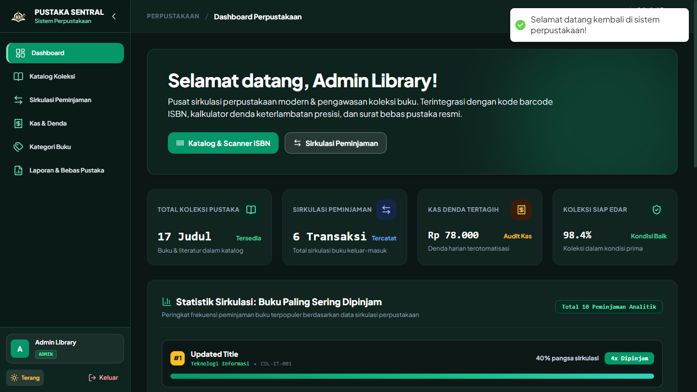
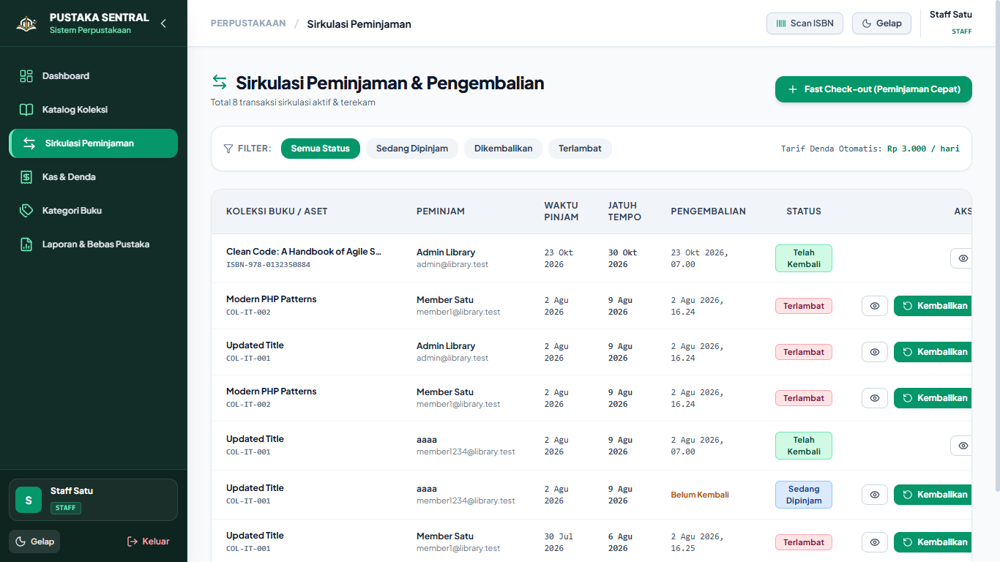
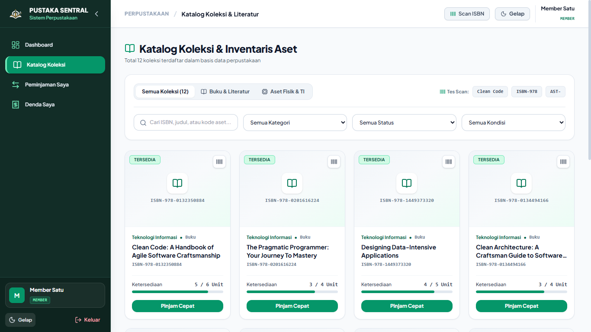

# PUSTAKA SENTRAL — Sistem Informasi Perpustakaan & Sirkulasi Koleksi (Frontend)

Modern, responsive web frontend untuk sistem informasi sirkulasi perpustakaan institusional terpadu. Dibangun dengan palet warna **Forest Pine & Mint** (`#122D27`), tata letak **Responsive Fluid Full-Width**, **Fixed Non-Scroll Sidebar Layout**, navigasi **Collapsible Sidebar**, dukungan **Dark Mode**, pemindaian **Barcode/ISBN**, **Chart Analitik Sirkulasi Buku Terpopuler**, sirkulasi **Fast Check-in/Check-out** dengan kalkulator denda otomatis presisi, serta penerbitan **Surat Keterangan Bebas Perpustakaan** resmi.

---

## 📸 Antarmuka Sistem & Portfolio Showcase

<p align="center">
  
  <br/>
  <em>Dashboard Pustaka Sentral — Tampilan Bersih Bebas Capsule AI-Slop, Tata Letak Full-Width Responsif, Sidebar Fixed Viewport, dan Chart Analitik Koleksi Terpopuler</em>
</p>

<details open>
<summary><strong>Lihat Dokumentasi Fitur & Multi-Role Antarmuka ▾</strong></summary>

| Fitur / Modul | Preview Antarmuka |
|---|---|
| **Login Mode Terang (Light Mode)**<br/>Antarmuka login resmi dengan lambang institusional Pustaka Sentral (Navy & Gold). |  |
| **Login Mode Gelap (Dark Mode)**<br/>Antarmuka login gelap dengan lambang adaptif kontras tinggi (White & Gold). |  |
| **Role Administrator (Admin)**<br/>Kendali penuh sistem perpustakaan, grafik analitik terpopuler, manajemen koleksi, denda, dan audit laporan. |  |
| **Role Staff Sirkulasi (Staff)**<br/>Operasional meja sirkulasi harian: peminjaman kilat (Fast Check-out), verifikasi pengembalian, dan hitung denda. |  |
| **Role Anggota (Member Dashboard)**<br/>Portal mandiri anggota untuk melacak buku yang sedang dipinjam, riwayat sirkulasi, dan status tanggungan denda. |  |
| **Role Anggota (Katalog & Peminjaman)**<br/>Pencarian katalog koleksi literatur kampus dengan fitur peminjaman mandiri 1-klik bagi mahasiswa. |  |
| **Chart Statistik Buku Terpopuler**<br/>Grafik batang analitik persentase frekuensi peminjaman koleksi buku paling diminati secara real-time. |  |
| **Format Sertifikat Bebas Pustaka Cetak**<br/>Layout kop surat resmi dengan validasi digital QR code & tanda tangan digital pustakawan untuk syarat yudisium. |  |

</details>

---

## 🏛️ Clean Architecture & Pemisahan Lapisan (Frontend)

Frontend menerapkan prinsip **Clean Architecture & Separation of Concerns** untuk memisahkan UI presentation dari data fetching, komunikasi HTTP, dan state management:

```
┌────────────────────────────────────────────────────────┐
│  Presentation Layer (UI Views & Layouts)               │
│  Pages, Modals, Shared Layout, Badges                  │
│  (src/pages, src/components)                           │
└───────────────────────────┬────────────────────────────┘
                            │ (Calls Hooks & Services)
                            ▼
┌────────────────────────────────────────────────────────┐
│  Application & Context Layer (State Management)        │
│  AuthContext, ThemeContext, Route Guards               │
│  (src/context, src/components/ProtectedRoute)          │
└───────────────────────────┬────────────────────────────┘
                            │ (Calls Domain Services)
                            ▼
┌────────────────────────────────────────────────────────┐
│  Domain Service Layer (Modular Domain API Clients)     │
│  authService, collectionService, borrowingService,     │
│  fineService, categoryService, reportService           │
│  (src/services/*.service.js, src/services/index.js)    │
└───────────────────────────┬────────────────────────────┘
                            │ (Uses Axios Client)
                            ▼
┌────────────────────────────────────────────────────────┐
│  Infrastructure Layer (Network & Storage Client)       │
│  Axios Instance, Bearer Token Interceptor, LocalStorage│
│  (src/services/api.js)                                 │
└────────────────────────────────────────────────────────┘
```

### Struktur Direktori Frontend:
- **`src/pages/`**: Komponen halaman utama (`Dashboard`, `Collections`, `Borrowings`, `Fines`, `Reports`, `Categories`, `Login`, `Profile`). Setiap halaman hanya fokus pada penyajian UI dan berinteraksi secara murni melalui domain service.
- **`src/components/`**: Komponen UI reusable (`SidebarLayout`, `ProtectedRoute`).
- **`src/context/`**: State context global (`AuthContext`, `ThemeContext`).
- **`src/services/`**: Modul domain service terisolasi (`auth.service.js`, `collection.service.js`, `borrowing.service.js`, `fine.service.js`, `category.service.js`, `report.service.js`) dengan barrel export di `index.js`.
- **`src/assets/`**: Asset biner resmi (logo, ikon, favicon) yang dibundel langsung via Vite ES module.

---

1. **Branding Pustaka Sentral**: Identitas sistem perpustakaan modern yang otentik, elegan, dan profesional.
2. **Fixed Sidebar Layout**: Sidebar navigasi terkunci penuh pada 100% viewport (`h-screen overflow-hidden`) tanpa perlu scroll ganda. Profil pengguna, Dark Mode switcher, dan tombol Logout selalu terlihat dan dapat diakses instan.
3. **Desain Bersih & Elegan (Anti AI-Slop)**: Menghilangkan pill/capsule status dekoratif dan tombol demo dummy, digantikan oleh badge terstruktur (`rounded-md`) yang bersih dan berstandar enterprise.
4. **Chart Analitik Sirkulasi Buku**: Visualisasi batang horizontal interaktif yang memeringkatkan buku paling sering dipinjam lengkap dengan badge ranking (`#1`, `#2`, `#3`), kategori literatur, ISBN, frekuensi transaksi, dan persentase pangsa pasar peminjaman.
5. **Responsive Fluid Full-Width Layout**: Tata letak fleksibel (`w-full`) yang beradaptasi sempurna dengan seluruh ukuran layar monitor (laptop, ultrawide, maupun desktop).
6. **Multi-Role Responsiveness**: Antarmuka adaptif dengan hak akses berjenjang untuk **Administrator**, **Staff Sirkulasi**, dan **Member Pembaca**.

---

## 🛠️ Tech Stack

| Komponen | Spesifikasi |
|---|---|
| **Framework** | React 18.3 |
| **Build Tool** | Vite 5.4 |
| **Styling** | Tailwind CSS 3.4 (Custom Theme & Dark Mode) |
| **Icons** | Lucide React |
| **Routing** | React Router DOM 6.26 |
| **HTTP Client** | Axios 1.7 |
| **Testing & E2E** | Playwright MCP |
| **Notifications** | React Hot Toast |

---

## 🚀 Menjalankan Project

```bash
# 1. Install dependencies
npm install

# 2. Jalankan dev server
npm run dev

# 3. Build untuk produksi
npm run build
```

---

## 🔗 Repository Terkait

- **Backend REST API (Laravel 13)**: [Salman-artz/library-asset-management-api](https://github.com/Salman-artz/library-asset-management-api)
- **Frontend Web (React & Vite)**: [Salman-artz/Library-Asset-Management-Frontend](https://github.com/Salman-artz/Library-Asset-Management-Frontend)
