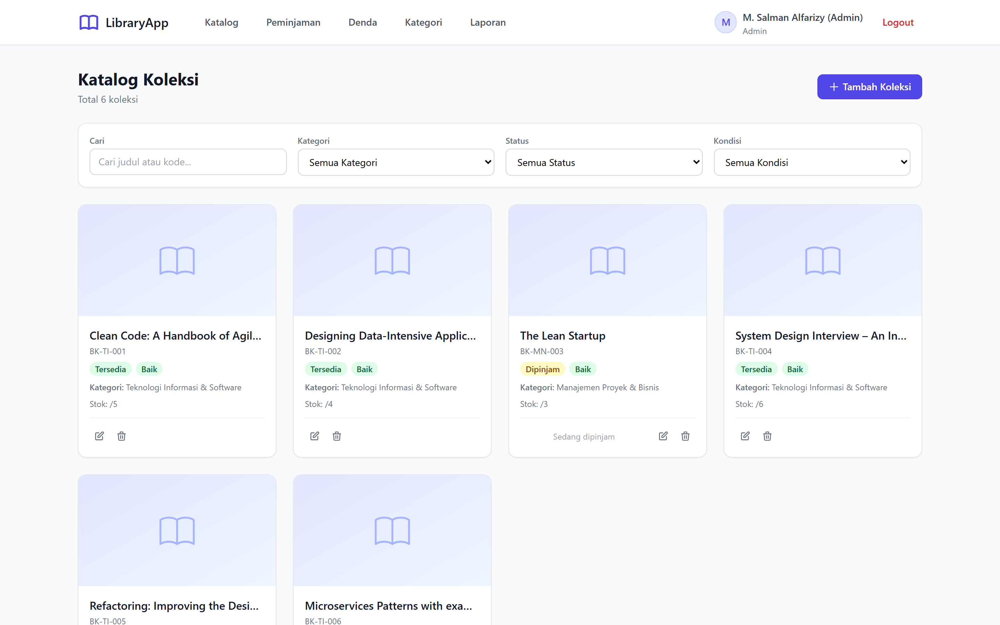
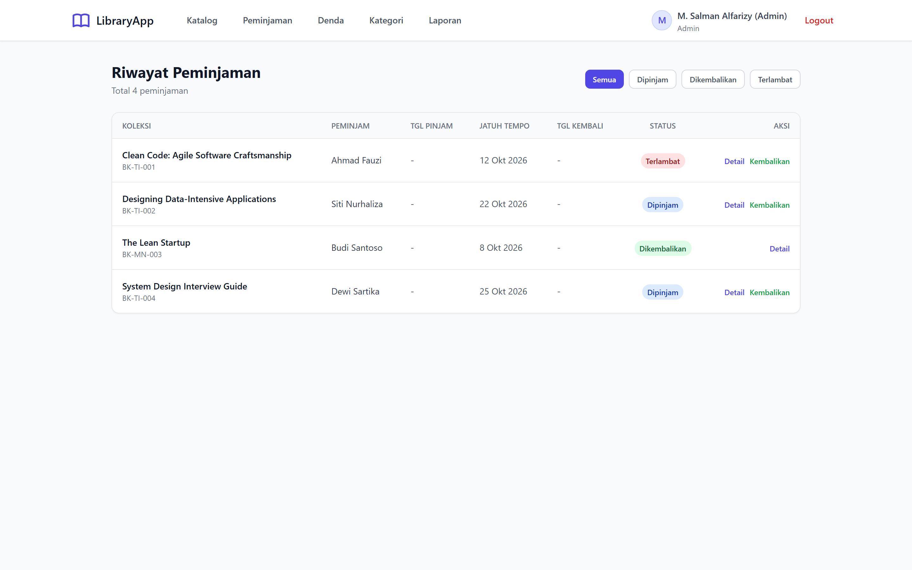
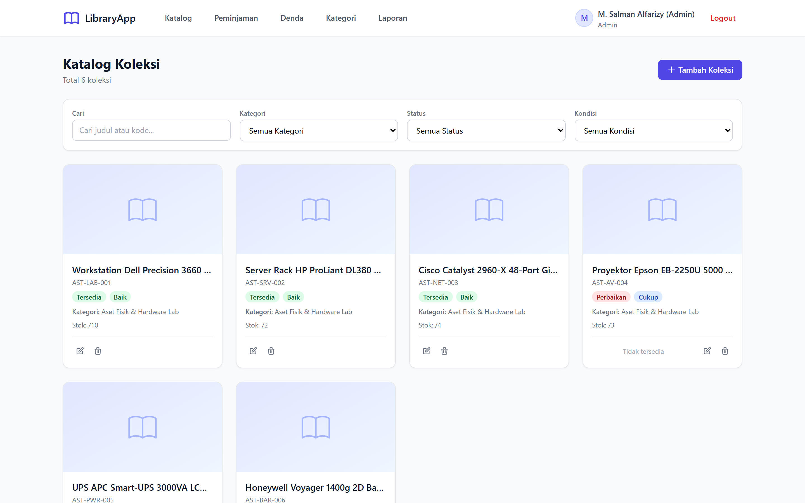
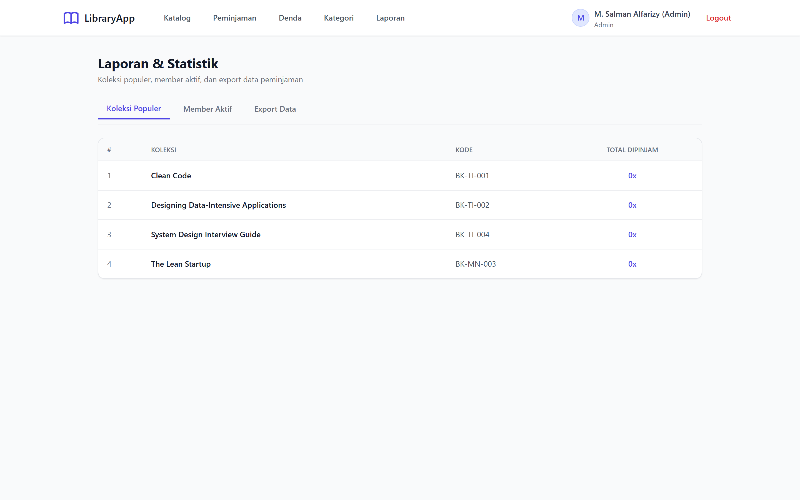

# Library & Asset Management Frontend

Frontend web untuk sistem manajemen perpustakaan dan aset institusi. Aplikasi ini digunakan oleh Admin, Staff, dan Member untuk mengelola katalog koleksi, peminjaman, pengembalian, denda, dan laporan.

Project dibangun menggunakan React, Vite, Tailwind CSS, dan React Router.

---

## 📸 Screenshots & Antarmuka Sistem

<p align="center">
  
  <br/>
  <em>Katalog Buku & Koleksi Perpustakaan dengan Filter Kategori & Ketersediaan</em>
</p>

<details open>
<summary><strong>Lihat Galeri Fitur Utama Lainnya ▾</strong></summary>

| Modul | Preview Antarmuka |
|---|---|
| **Sirkulasi Peminjaman & Denda**<br/>Tabel peminjaman aktif, batas jatuh tempo, status kembali, dan denda keterlambatan otomatis. |  |
| **Tracking Aset Fisik Organisasi**<br/>Inventarisasi perangkat lab & server dengan kode barcode, kondisi barang, dan lokasi ruangan. |  |
| **Laporan Statistik & Dashboard Admin**<br/>Ringkasan buku terpopuler, anggota paling aktif, dan modul ekspor data laporan. |  |

</details>

---

## Fitur

- Login dan register pengguna
- Role-based navigation untuk Admin, Staff, dan Member
- Dashboard ringkasan aktivitas perpustakaan
- Katalog koleksi dengan pencarian dan filter
- Manajemen kategori dan koleksi
- Peminjaman dan pengembalian koleksi
- Monitoring denda dan pembayaran
- Laporan koleksi populer dan anggota aktif
- Notifikasi aksi menggunakan React Hot Toast
- Protected route untuk halaman yang membutuhkan autentikasi

## Tech Stack

| Area | Teknologi |
| --- | --- |
| UI | React 18 |
| Build tool | Vite 5 |
| Styling | Tailwind CSS 3 |
| Routing | React Router DOM 6 |
| HTTP client | Axios |
| Authentication state | React Context |
| Notifications | React Hot Toast |

## Prasyarat

- Node.js 18 atau lebih baru
- npm
- Library Asset Management API berjalan

## Instalasi

```bash
git clone git@github.com:Salman-artz/Library-Asset-Management-Frontend.git
cd library-aset-frontend
npm install
copy .env.example .env
```

Atur alamat API pada file `.env`:

```env
VITE_API_BASE_URL=http://localhost/library-aset-manajemen/public/api
```

Sesuaikan URL tersebut jika backend dijalankan menggunakan `php artisan serve` atau host yang berbeda.

## Menjalankan Project

Development server:

```bash
npm run dev
```

Aplikasi tersedia di `http://localhost:5173`.

Build dan preview production:

```bash
npm run build
npm run preview
```

## Integrasi Backend

Frontend menggunakan Axios untuk mengakses endpoint backend dan menyimpan token autentikasi untuk request protected. Backend API menggunakan prefix `/api`.

Pastikan backend Laravel sudah aktif:

```bash
cd ../library-aset-manajemen
php artisan serve
```

Jika memakai Sanctum bearer token, request protected dikirim dengan header:

```text
Authorization: Bearer <token>
```

## Halaman Utama

| Area | Route |
| --- | --- |
| Login | `/login` |
| Register | `/register` |
| Dashboard | `/dashboard` |
| Koleksi | `/collections` |
| Kategori | `/categories` |
| Peminjaman | `/borrowings` |
| Denda | `/fines` |
| Laporan | `/reports` |

## Struktur Project

```text
src/
  components/        Komponen reusable dan protected route
  context/           AuthContext dan state autentikasi
  pages/             Halaman login, dashboard, koleksi, dan laporan
  services/          Service Axios untuk komunikasi API
  App.jsx            Routing utama aplikasi
  main.jsx           Entry point React
  index.css          Import Tailwind CSS
public/              Asset publik
```

## Akun Demo

| Role | Email | Password |
| --- | --- | --- |
| Admin | `admin@library.test` | `password` |
| Staff | `staff1@library.test` | `password` |
| Member | `member1@library.test` | `password` |

## Repository Terkait

- Frontend: https://github.com/Salman-artz/Library-Asset-Management-Frontend
- Backend: https://github.com/Salman-artz/library-asset-management-api

## License

MIT
