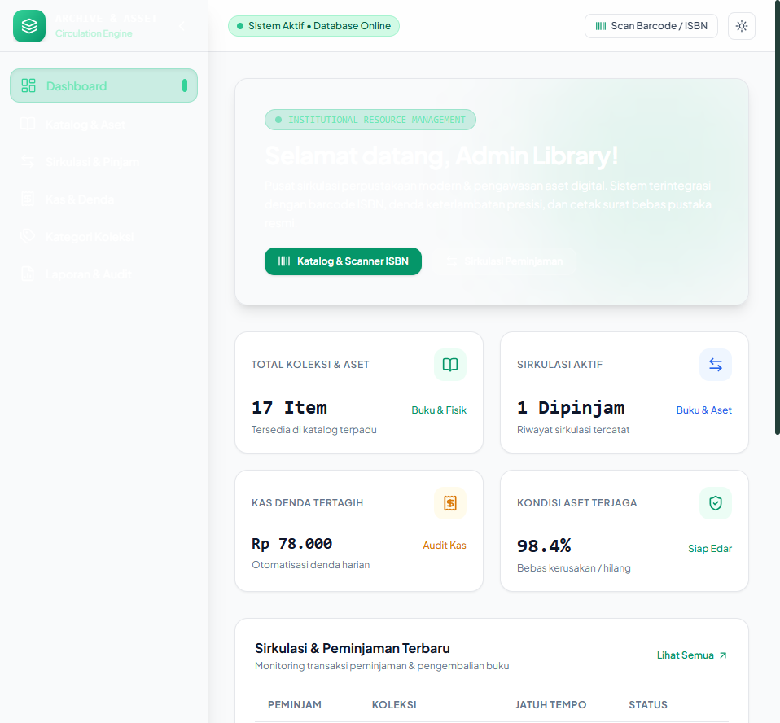
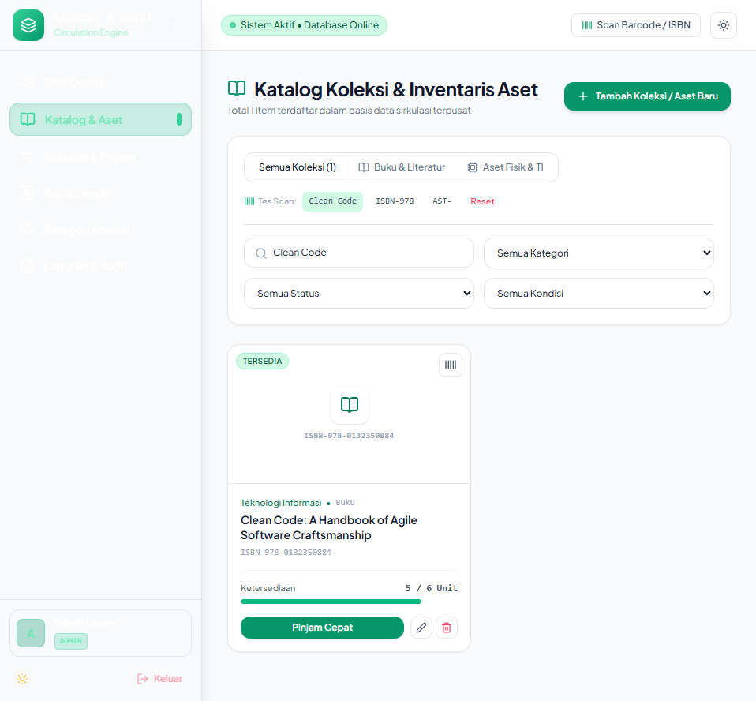
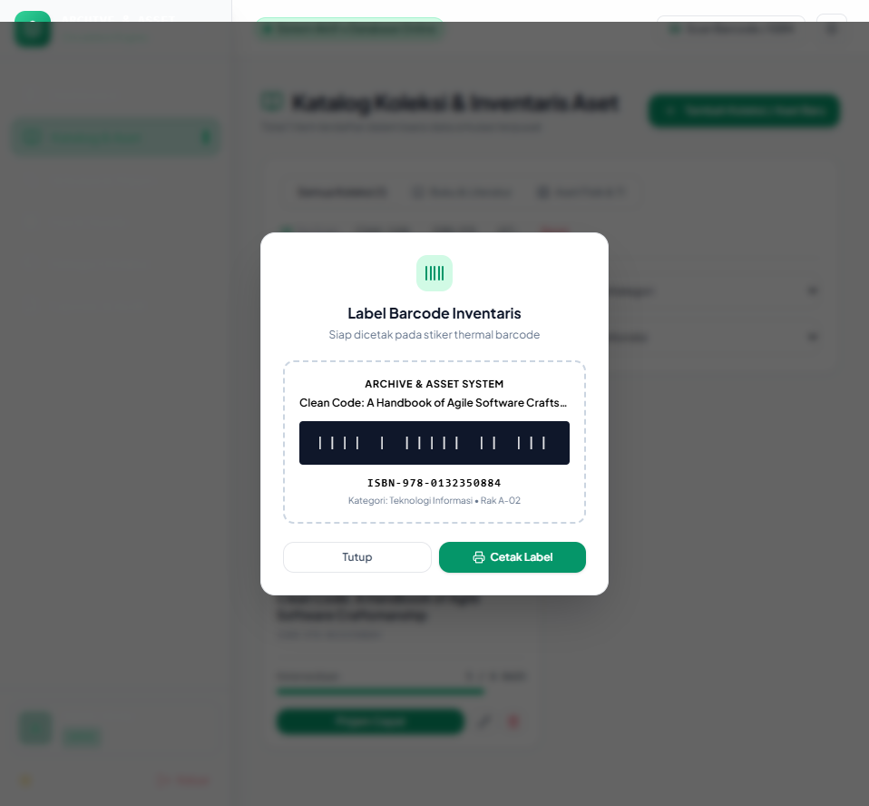
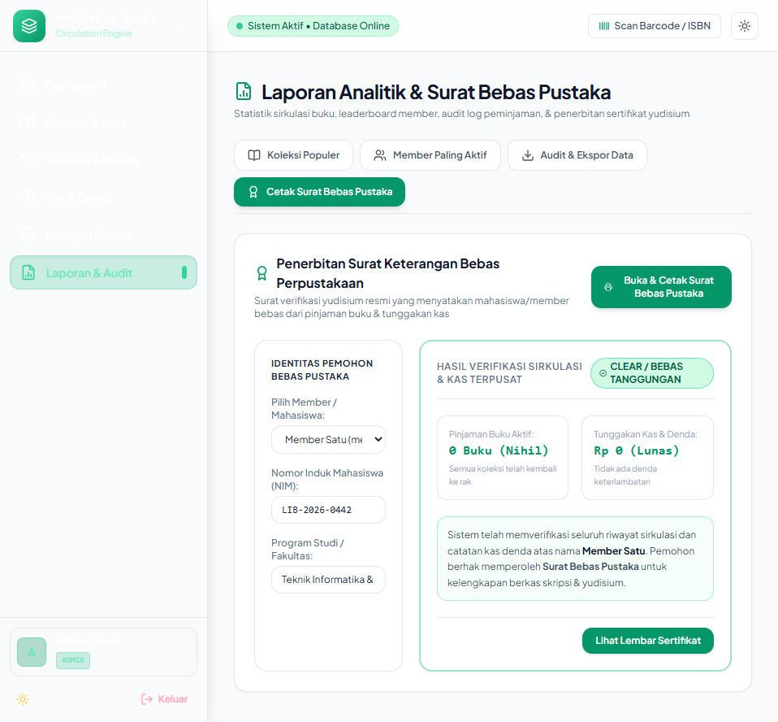

# ARCHIVE & ASSET — Enterprise Library & Asset Circulation System (Frontend)

Modern, quiet-luxury web frontend untuk sistem sirkulasi terpadu perpustakaan dan manajemen aset fisik institusional. Dibangun dengan tema **Sage Forest & Warm Sand**, tata letak **Collapsible Enterprise Sidebar**, dukungan **Dark Mode**, pemindaian **Barcode/ISBN**, sirkulasi **Fast Check-in/Check-out** dengan kalkulator denda otomatis presisi, serta penerbitan **Surat Keterangan Bebas Perpustakaan** resmi.

---

## 📸 Antarmuka Sistem & Portfolio Gallery

<p align="center">
  
  <br/>
  <em>Enterprise Circulation Dashboard — Sage Forest & Warm Sand Palette</em>
</p>

<details open>
<summary><strong>Lihat Dokumentasi Fitur Utama ▾</strong></summary>

| Fitur / Modul | Preview Antarmuka |
|---|---|
| **Dark Mode & Institutional Sidebar**<br/>Navigasi collapsible dengan kontrol tema real-time dan audit sirkulasi aktif. |  |
| **Katalog & Filter Barcode ISBN**<br/>Pencarian instan kode ISBN/barcode, filter literatur vs perangkat TI, dan stok meter. |  |
| **Pencarian Kilat & Tes Scan ISBN**<br/>Deteksi cepat barcode buku dengan modal cetak label stiker inventaris. |  |
| **Label Barcode Inventaris Siap Cetak**<br/>Modal stiker barcode thermal standar UPT Perpustakaan. |  |
| **Sirkulasi & Fast Check-out**<br/>Peminjaman kilat terintegrasi dengan durasi adaptif (7/14/30 hari). |  |
| **1-Click Return & Kalkulator Denda**<br/>Perhitungan otomatis keterlambatan harian (Rp 3.000/hari) saat barang dikembalikan. |  |
| **Penerbitan Surat Bebas Pustaka Resmi**<br/>Verifikasi otomatis tanggungan pinjaman & kas denda untuk syarat yudisium/wisuda. |  |
| **Format Sertifikat Bebas Pustaka Cetak**<br/>Layout kop surat resmi dengan validasi digital QR code & tanda tangan kepala pustakawan. |  |
| **Manajemen Kas & Denda Keterlambatan**<br/>Monitoring kas masuk, audit denda per member, dan verifikasi status lunas. |  |

</details>

---

## ✨ Fitur Unggulan

1. **Sage Forest & Warm Sand Design System**: Palet warna Deep Forest Sage (`#1B3B36`), Emerald Mint (`#10B981`), dan Alabaster Sand (`#FAF9F6`) dengan typography Plus Jakarta Sans.
2. **Collapsible Enterprise Sidebar & Dark Mode**: Sidebar modern dengan status sistem real-time, profile badge, dan switch tema instan yang tersimpan di localStorage.
3. **Pencarian Barcode & ISBN Real-time**: Quick filters untuk membedakan buku literatur vs aset fisik hardware institusi.
4. **Fast Check-in / Check-out**: Peminjaman kilat tanpa reload dengan pemilihan durasi pinjaman standar.
5. **Kalkulator Denda Keterlambatan Otomatis**: Dialog konfirmasi pengembalian yang menghitung jumlah hari terlambat dan nominal denda secara presisi sebelum status diubah.
6. **Ekspor Multi-Format & Surat Bebas Pustaka**: Laporan dalam bentuk PDF & CSV Excel, serta modal cetak Surat Bebas Perpustakaan siap cetak via browser.

---

## 🛠️ Tech Stack

| Komponen | Spesifikasi |
|---|---|
| **Framework** | React 18.3 |
| **Build Tool** | Vite 5.4 |
| **Styling** | Tailwind CSS 3.4 (Custom Theme & Dark Mode) |
| **Icons** | Lucide React |
| **Routing** | React Router DOM 6.26 |
| **HTTP Client** | Axios 1.7 |
| **Notifications** | React Hot Toast |

---

## 🚀 Menjalankan Project

```bash
# Install dependencies
npm install

# Jalankan dev server
npm run dev

# Build untuk produksi
npm run build
```
